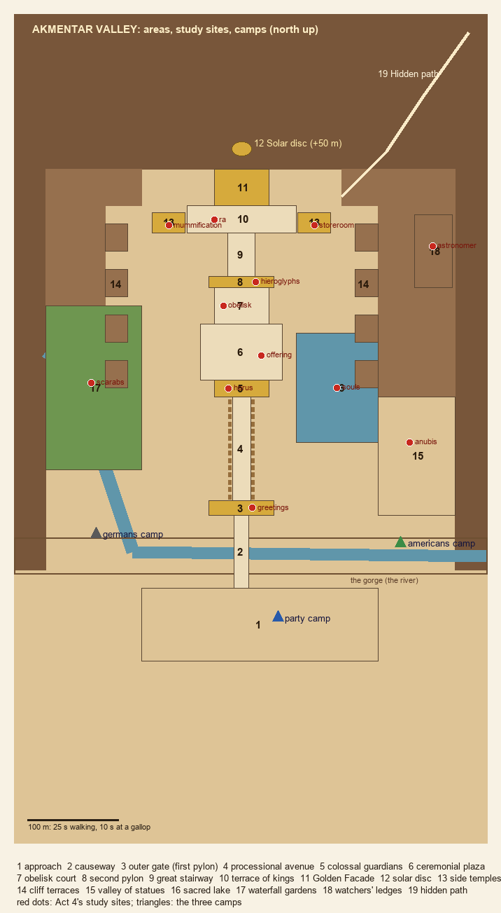
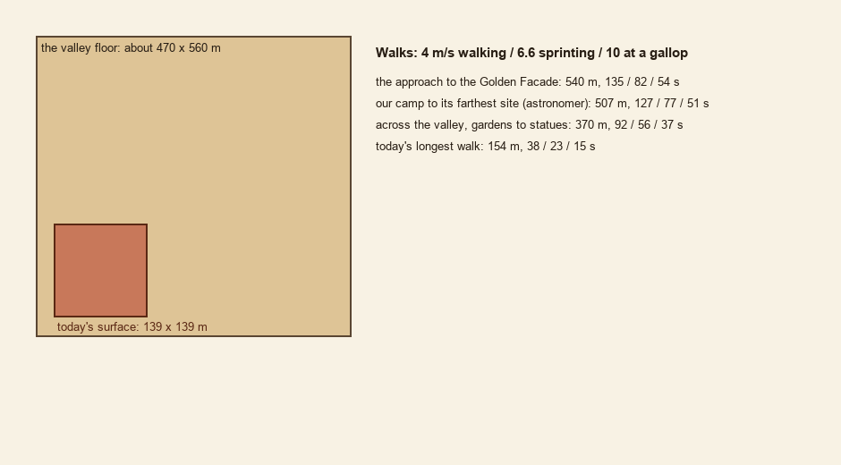
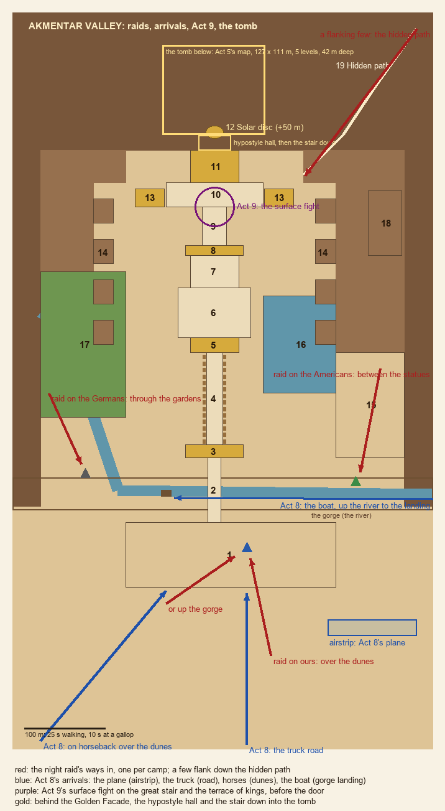

# Akmentar: the valley plan (draft, for approval before building)

*28 October 2026, by -f9. A plan only: nothing is built. It goes to the lead and Simon first.*

The goal is Simon's target map, [`reference/tomb_look/target_golden_pharaoh_map_v2.png`](reference/tomb_look/target_golden_pharaoh_map_v2.png): a whole valley carved into the mountains, with a processional way from the desert to a golden facade in the cliff.

## What changes

**Today:** the surface is a 139 × 139 m walled court on flat sand. Its longest walk is 154 m, 39 s on foot ([world audit](world_audit.md), section 7). It is about a seventh of the target's scale.

**The plan:** a valley about **470 m wide and 560 m deep**, closed by cliffs on three sides and by the gorge and the desert to the south.
- **The core:** a 520 m processional axis from the desert approach to the Golden Facade.
- **The cliffs:** they rise 40 to 120 m round the valley, so it looks much bigger than you can walk.
- **The scale bar:** the target's 500 m scale bar would make the valley kilometres across. That is too big to cross in a working day on foot, so the cliffs and the mountains beyond carry that scale as backdrop.

**Walks** (walking 4 m/s, sprinting 6.6, galloping 10):

| Walk | Distance | Walk | Sprint | Gallop |
|---|---|---|---|---|
| The approach to the Golden Facade | 540 m | 2 min 15 s | 82 s | 54 s |
| Across the valley, the gardens to the statues | 370 m | 92 s | 56 s | 37 s |
| Our camp to its farthest site (the watchers' ledges) | 507 m | 2 min 07 s | 77 s | 51 s |
| Today's longest walk | 154 m | 39 s | 23 s | 15 s |

**Horses at the camps.** Simon's design has you walking the ruins all day and talking to people at their work, so the expedition's horses stand at the camp, and you can ride between the sites. The horse code already exists.

## The valley's areas

Numbered as in Simon's map. Positions are in metres: x is east, z is south (the code's axes), and the Golden Facade's foot is at z 0.

1. **Desert approach** (z 460–540, 260 m wide). Open sand and dunes before the gorge; palms and the first broken statues. Our camp is here. The truck road and the horse tracks arrive here (Act 8).
2. **Royal causeway** (z 380–460, 16 m wide, 6 m above the gorge). A stone causeway with balustrades and stairs at each end, over the gorge and the river. The boat landing is below it, at the gorge's foot (Act 8).
3. **Outer gate, the first pylon** (z 364–380). Two pylon towers 24 m tall, a gate 8 m wide, flagpoles with pennants.
4. **Processional avenue** (z 250–364, 20 m wide). About 30 ram sphinxes a side, palms between them.
5. **Colossal guardians** (z 232–250). Two 18 m seated colossi either side of the avenue's end.
6. **Ceremonial plaza** (z 170–232, 90 × 62 m). Paved, with colonnades on both sides; the sacred lake opens to its east.
7. **Obelisk court** (z 130–170). Four obelisks 20 m tall; one has fallen and broken.
8. **Second pylon** (z 118–130). As the first, with reliefs and a smaller gate.
9. **Great stairway** (z 70–118, 30 m wide). It rises 18 m in flights with landings.
10. **Terrace of kings** (z 40–70, +18 m). A long terrace lined with Osiride pillars, before the facade.
11. **The Golden Facade** (z 0–40, at the cliff foot). A cliff-carved front with four seated colossi either side of a glowing golden door. The door leads into the tomb.
12. **Solar disc**. Carved in the cliff 50 m above the facade.
13. **Side temples**. Two rock-cut temples off the terrace, west and east (x ±80), with porticoes.
14. **Cliff terraces**. Stepped terraces cut into both cliffs (x ±125 to ±150), reached by ramps. They look down on the plaza.
15. **Valley of statues** (east, x 150–235, z 250–380). A side valley of weathered colossi and Osiride pillars half in the sand. The Americans camp at its mouth.
16. **Sacred lake** (x 60–150, z 180–300). A stepped rectangular lake with a small shrine.
17. **Waterfall gardens** (west, x −215 to −110, z 150–330). The river falls 30 m off the west cliff into pools under palms; it reaches the gorge from here. The Germans camp at their foot.
18. **Watchers' ledges** (east cliff, x 190–232, z 50–130, +35 m). A ledge cut high in the cliff, reached by a rock-cut stair. It looks over the whole valley.
19. **Hidden path**. A ravine behind the east side temple, up to the rear cliffs. It's a way in for a flanking few in a raid, and maybe a way out.

## Act 4: the study sites and the camps

Each of the 12 sites moves into an area that fits it.

| Site | Area | Position (x, z) |
|---|---|---|
| greetings | 3 the outer gate's reliefs | 12, 372 |
| horus | 5 the falcon-headed guardian | −14, 241 |
| offering | 6 the plaza's offering table | 22, 205 |
| obelisk | 7 the obelisk court | −20, 150 |
| hieroglyphs | 8 the second pylon's inscriptions | 16, 124 |
| ra | 10 the terrace below the solar disc | −30, 56 |
| mummification | 13 the west side temple (an embalming house) | −80, 62 |
| storeroom | 13 the east side temple (its magazines) | 80, 62 |
| souls | 16 the sacred lake's shrine | 105, 240 |
| anubis | 15 the valley of statues | 185, 300 |
| scarabs | 17 a grotto in the waterfall gardens | −165, 235 |
| astronomer | 18 the watchers' ledges | 210, 85 |

**The camps, and the claim race (Simon's answer 3, below: one shared start).**
- **The camps stay for the night:** ours (40, 492) on the desert approach, the Americans (190, 388) at the mouth of the valley of statues, the Germans (−160, 388) at the foot of the waterfall gardens. They are where people sleep and where the crews walk from each day; they no longer decide the race.
- **The race starts at one place for all three:** the valley's approach, at the south end of the causeway over the gorge (0, 470). Every expedition rides in to the same point; whoever arrives first (the race from Act 3, and the travel choices) picks first at the claim board, then the others in arrival order, and so on round.
- **So the distances that matter are from that start**, the same for everyone. Near sites are quick to reach and to work; far ones cost the crew's day. Measured on the navmesh (tests/akmentar_valley_test --from=0,470):

| Site | From the approach | Walking | At a gallop |
|---|---|---|---|
| greetings | 91 m | 23 s | 9 s |
| horus | 230 m | 58 s | 23 s |
| offering | 266 m | 66 s | 27 s |
| anubis | 272 m | 68 s | 27 s |
| souls | 289 m | 72 s | 29 s |
| scarabs | 299 m | 75 s | 30 s |
| hieroglyphs | 333 m | 83 s | 33 s |
| obelisk | 337 m | 84 s | 34 s |
| ra | 427 m | 107 s | 43 s |
| storeroom | 473 m | 118 s | 47 s |
| mummification | 473 m | 118 s | 47 s |
| astronomer | 482 m | 120 s | 48 s |

- **What decides a pick now:** what the site is worth (its clue, and what it gives in Act 9) against how far in it lies. The first to arrive can take a far, rich site (the astronomer, the storeroom) before the others, or several near ones.
- **The rivals' picks:** each rival's preference (the Americans the impressive and valuable, the Germans the scholarly) orders their list; the distance from the approach breaks ties.
- **Unchanged:** CampJobs' crews and companions work the claimed sites wherever they are, walking out from their own camp each day.

## The night raid, Act 8's arrivals, Act 9, the tomb

**The night raid** (NightRaid). Each camp is attacked from its own side:
- **Ours:** over the dunes from the south, or up the gorge.
- **The Americans':** between the statues.
- **The Germans':** through the garden palms.
- **The hidden path:** a few come down it to flank.

With camps 330 m apart, the waves come in from much farther than today's 34 m (SPAWN_DIST becomes per camp and per way in). The raid on the others' camps is now heard, not seen: the gunfire carries (CombatSound's distant pops) and the flashes show over the cliffs.

**Act 8's arrivals.** Each way of travelling arrives somewhere different, then walks or rides to the facade:
- **The plane:** an airstrip on the flat pan south-east of the approach (x 140–250, z 580–600).
- **The truck:** the desert road from the south, to the approach.
- **Horses:** over the dunes from the south-west, to the approach.
- **The boat:** up the river into the gorge, to a landing under the causeway, with stairs up onto it.

**Act 9's surface fight.** It moves out of the tomb's first level, up onto the valley: the great stairway and the terrace of kings, before the Golden Facade.
- **The enemies:** mummies wake from the Osiride pillars along the terrace.
- **Cover:** the colossi's bases and the stair's landings.
- **The way down:** through the door, which then opens onto the descent.

**The tomb entrance.**
- **The hall:** behind the Golden Facade's door is a new hypostyle hall, about 40 × 18 m, inside the cliff. It has painted columns and a star ceiling, built in Godot like the Cairo interiors.
- **The way down:** a stair at its far end leads into Act 5's tomb (AkmentarBelow: 127 × 111 m, five levels, 42 m deep). The tomb stays as it is.
- **Its place:** on the map it lies under the cliff behind the facade.
- **The transition:** the scene loads at the foot of the hall's stair, as now.

## The models

The 18 Akmentar briefs in [`asset_briefs.md`](asset_briefs.md) cover most of it:

| Brief | Used in areas |
|---|---|
| `akm_colossus_seated` | 5 (×2), 11 (×4), 15 (weathered copies) |
| `akm_osiride_pillar` | 10 (the terrace's line), 15, 13 |
| `akm_ram_sphinx` | 4 (about 60) |
| `akm_column_base`, `_shaft`, `_capital` | 6 (the plaza's colonnades), the hypostyle hall |
| `akm_pylon_face`, `akm_pylon_cornice` | 3, 8 |
| `akm_obelisk` | 7 (×4, one fallen) |
| `akm_golden_door_frame`, `akm_golden_door_leaf` | 11 |
| `akm_solar_disc` | 12 |
| `akm_facade_wall`, `akm_facade_door`, `akm_facade_portico` | 11, 13, 14 |
| `akm_cliff_face` | the valley walls, 14, 18 |
| `akm_grand_stair` | 9, 2's end stairs, 18's stair |
| `akm_lake_edge` | 16 |

**Gaps** (new briefs, not sent; for Simon to approve with the rest):

| Asset | Size | Kind | For |
|---|---|---|---|
| `akm_causeway_section` with balustrade | 16 × 8 m, piers below | module | 2 |
| `akm_flagpole_pennant` | 18 m pole, cloth | kit | 3, 8 |
| `akm_offering_table` / altar | 2 × 1 m | kit | 6 (the offering site) |
| `akm_lake_shrine` | 6 × 6 × 7 m kiosk | one-off | 16 (the souls site) |
| `akm_terrace_balustrade` | 4 m | module | 10, 14, 18 |
| `akm_painted_ceiling` (stars on blue) | 4 × 4 m | module | the hypostyle hall |
| `akm_rubble` (fallen blocks, drums) | 1–4 m | kit ×3 | 15, the approach, the fallen obelisk |
| `akm_human_sphinx` | 6 m | kit | 1, 15 (variety beside the rams) |
| airstrip windsock and hut (period) | 3–5 m | kit | the airstrip |

**Done in Godot rather than modelled:**
- the waterfalls (a scrolling shader and spray particles);
- the river and lake water (RiverWater);
- the palms, the gold glow of the facade's door, and the dust.

**Reused:** the river landing stage (the river section's brief), the tents and the camp kit.

## What the code needs

1. **akmentar_surface.gd:** the valley in blockout first, as -7f did Cairo's stage 1: the cliffs, the axis and the areas in boxes. Then the kit as it arrives. SITES and CAMPS take the positions above.
2. **The navmesh:** about 0.2 km² of walkable ground (the valley is 0.26 km² with its cliffs). Bake it once into a resource (a tool, or at the first load) rather than every load, and on a thread if it passes 1 s.
3. **Act 4:**
   - the sites' positions;
   - horses for riding at our camp;
   - the claim board's view (the map's sites, the distances shown).
4. **NightRaid:** ways in per camp (above); SPAWN_DIST per way in.
5. **Act 8:**
   - the arrival points for the plane, truck, horses and boat;
   - the airstrip;
   - the boat landing.
6. **Act 9:** the surface fight on the terrace (above), then the hypostyle hall and the stair down.
7. **-f9's parts:**
   - CampJobs anchors from the new camps;
   - crowd/akmentar_camps.json regenerated for the new camps;
   - AmbientLife: kites over the valley, birds at the lake, bats at dusk by the cliffs;
   - SoundLife: the falls' roar, digging, the camps;
   - Weather: wind and sand in the approach, mist at the falls;
   - the hypostyle hall's interior (CairoInteriors' kit).
8. **Tests:**
   - the act4, act8, act9 and retry runs;
   - camp_jobs_test's anchors;
   - a valley test: every site and camp reachable, the walk times above.

**Stages** (each leaves the game playable):
1. **Blockout:** the valley in boxes, with everything moved and green. Today's surface stays the game's, as `akmentar_valley` beside it, until Simon approves (as Cairo v2).
2. **The landmarks:** the colossi, the facade, the pylons, the obelisks.
3. **The kit:** the sphinxes, the pillars, the columns, the cliffs, the stairs, the lake.
4. **Life, water and light:** the falls, the lake, the crowds, the night.

## Budget

Measured today against the plan:

| | Today | Plan |
|---|---|---|
| Walkable ground | 18,000 m² | about 200,000 m² (of 263,000 with the cliffs) |
| Draw calls, high | (to measure) | under about 1,500 |
| Frame rate | (to measure) | 120 fps on high, 60 on low |

- **Draw calls:** the static merge keeps them down, as in Cairo; one mesh per 24 m cell and material.
- **The big models:**
  - **Triangles:** 6 colossi at 40k and about 60 sphinxes at 15k come to about 1.1M triangles in view at most. Godot's import LODs and visibility ranges keep the far ones cheap.
  - **The sphinxes:** they are in a straight line, so a MultiMesh per variant would make them 2 draw calls.
- **Frame rate:** the target is held by the merge, the LODs and the crowd's LOD.
- **Memory:** about +250 MB of new textures (18–27 models at about 5–16 MB each), against Act 4's budget.
- **Loading:** the navmesh baked ahead (above); the scene loads behind the loading card.
- **Building it:**
  - **GPU time:** about 3 hours for the 18 briefs, plus about 1.5 hours for the 9 gaps (image-to-3d's figures). That is 4–5 holds.
  - **Blockout:** stage 1 needs no models.

## Questions for Simon

1. **Size.** A valley of about 470 × 560 m: 2¼ minutes on foot from the desert to the golden door, under a minute on horseback, with the kilometres of the map as cliffs and mountains beyond. Is that the right feel, or should it be bigger and ridden through on horseback?
2. **The river.** The map shows a river and waterfalls. Here the river comes over the west cliff in falls, crosses under the causeway in a gorge, and gives Act 8's boat its landing. Is that the river you want, or should the valley open onto the Nile itself?
3. **The camps.** The rivals camp inside the valley (by the statues, by the gardens) and we camp outside it, on the approach. Being farther out is part of the claim race. Or should all three camp outside, on the approach?
4. **The hidden path.** A way in for raiders and a way out, or something to find: a secret route to the tomb's lower levels, or to Act 9's end?

## Simon's answers (2026-10-28)

1. **Size:** keep it as it is for now.
2. **The river:** as planned, over the west cliff in falls and through the gorge under the causeway, with Act 8's boat landing. "That sounds excellent!"
3. **The camps and the race:** all three expeditions start the claim race from the same point; it is not run from the camps. Arrival order decides it, from a shared start (the approach, above). The camps stay where they are, for the night.
4. **The hidden path:** a secret, something to find. A proposal for what it leads to, and the clue trail to it, goes to the lead before anything is built.
