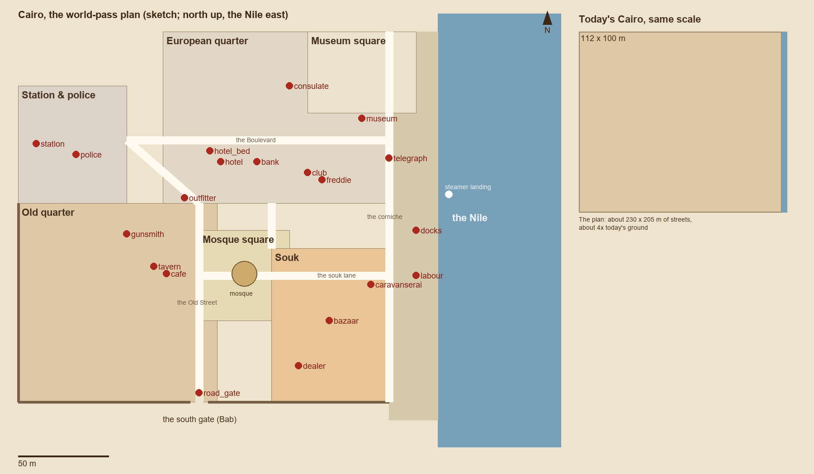
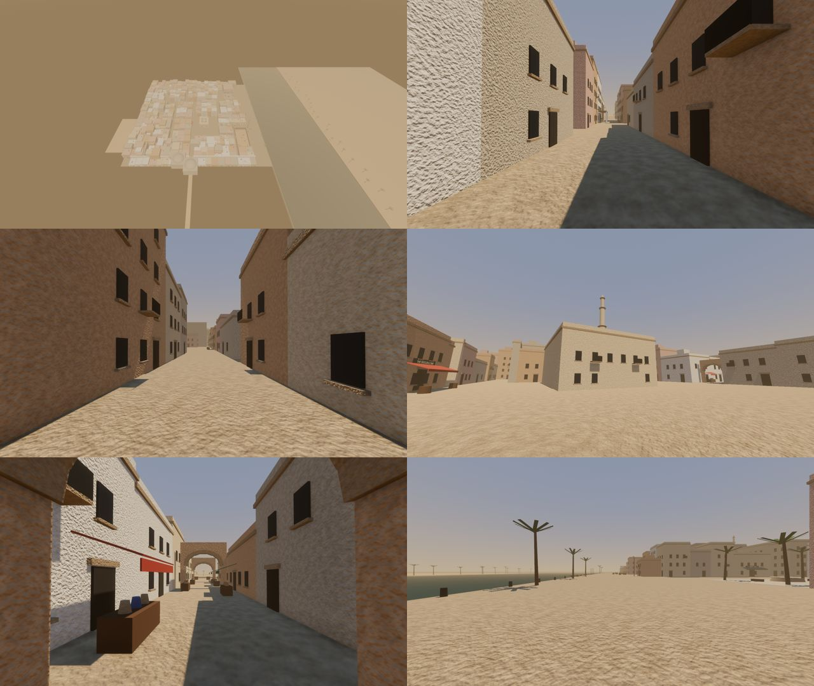

# Cairo: the world-pass plan (draft, for approval before building)

*28 October 2026. A plan only: nothing is built yet. It goes to the lead and Simon first.*

## What changes

**Today:** Cairo is 112 × 100 m of streets: one grid of the same plaster block. The farthest point is 26 s at a walk ([world audit](world_audit.md), section 1).

**The plan:**
- **Size.** About **230 × 205 m of streets**, plus a 27 m Nile front (the corniche and quay) and the river: about **4× the ground**.
- **Districts.** Seven areas that look and sound different, each with something to see:
  - the European quarter, around the Boulevard and the museum square;
  - the station and police;
  - the old quarter;
  - a mosque square;
  - the souk;
  - the Nile front with the docks;
  - the south gate.
- **Walks.** Longest about 300 m: about **75 s at a walk** and 45 s at a sprint. Typical errands:

| Errand | Distance | Time at a walk |
|---|---|---|
| Hotel to bazaar | about 140 m | 35 s |
| Station to docks | about 230 m | 60 s |
| Gate to museum | about 250 m | 65 s |

## What doesn't change

- **Every spot keeps its role and id.** Acts 1, 2, 7 and 8 find places by id (`level.spots`, `near_spot`), so they follow the new positions without edits.
- **The interiors.** -f9's rooms move with their buildings: their venue's shell is found by its centre, so the rooms get rebuilt against the new building rectangles with -f9.
- **The flows:**
  - **Act 1:** arrive at the docks; Freddie's office in the club; Karim at the café; the brawl; the market chase; the armed men.
  - **Act 2:** start by the hotel; hiring at each spot; sleep at the hotel.
  - **Act 6:** arrive inside the south gate.
  - **Act 7:**
    - the curse signs;
    - the five places the thieves can leave from: docks, station, police, the gate, the hotel;
    - returning the artifacts at the bank.
  - **Act 8:** the routes out: the river from the steamer landing, the road from the gate, the airstrip outside town.
- **The tests that check these** (resume, retry, the act runs) must stay green at every stage.

## The districts

### European quarter (north, about 125 × 95 m, with the museum square on the Nile)

- **Character:** a 1920s Ismailia-style quarter. A tree-lined **Boulevard** runs west to east from the station to the corniche, between three-storey cream stucco blocks (`cai_euro_bay`) with iron balconies and shop arcades.
- **Spots:**
  - **hotel** and **hotel_bed** on the Boulevard: a terrace café out front, the lobby inside.
  - **bank** next to the hotel (Act 7's return).
  - **club** with **freddie** on a side street.
  - **consulate** off the square.
  - **telegraph** on the corniche.
  - **outfitter** at the corner where the quarter meets the old town.
- **Museum square:** the museum stands on its own square by the Nile, a monumental neoclassical front facing south: a big open space with a fountain, palms and a statue.
- **To see:** horse cabs, a policeman directing traffic, a newspaper kiosk, café tables, the museum's steps, a felucca landing on the corniche.

### Station & police (north-west, about 60 × 65 m)

- **Character:** the railway station's long front and a square for cabs and porters (**station**), with police headquarters on the square's corner (**police**).
- **Role:** Act 7's station and police escapes leave from here; the thieves' cars wait in the square.
- **To see:** a locomotive's smoke beyond the roof, luggage carts, porters, a drinking fountain.

### Old quarter (west and centre, about 110 × 110 m)

- **Character:** narrow winding lanes 3–5 m wide between Cairene houses (`cai_house_shop`, `cai_house_upper` with mashrabiya bays, `cai_house_roofline`, `cai_house_corner`). Small courtyards, a covered passage or two, rooftop terraces you can see but not reach.
- **The Old Street:** runs north to south from the outfitter to the gate, the old quarter's spine.
- **Spots:** **gunsmith**; **tavern** with the **cafe** inside it (-f9's interior).
- **To see:** washing between windows (solid shapes), a water seller, children, a carpenter's workshop, a sabil (public fountain).

### Mosque square (centre, about 50 × 50 m)

- **Character:** the city's hinge between the old quarter, the souk and the Boulevard. A Mamluk mosque (`cai_mosque_dome`, `cai_minaret`, `cai_mosque_wall`, `cai_mosque_portal`) faces an open square with a fountain and café tables.
- **The call to prayer:** -f9's `SoundLife.call_to_prayer` moves to this minaret.
- **Role:** no spot needs it, but it's the landmark you navigate by. The minaret is visible from everywhere.

### Souk (south-east, about 65 × 85 m)

- **Character:** the **souk lane** runs from the mosque square to the corniche. Off it are covered vaulted lanes (`cai_souk_vault`) and lanes under awnings (`cai_awning`), packed with stalls (`cairo_market_stall`, spice baskets, carpets, water jars).
- **Spots:**
  - **bazaar** in the middle;
  - **dealer** in a quieter corner;
  - **caravanserai** where the souk meets the docks (its courtyard, camels, the guides' corner).
- **The market chase (Act 1):** it gets a real route here, from the bazaar through the covered lanes and the mosque square to the gate. That's about 180 m instead of today's 70.

### Nile front and docks (east edge, 27 m of corniche and quay along the whole city)

- **Character:** the stone quay (`cai_quay_wall` with mooring rings and steps), bollards and ladders, feluccas moored and sailing (`cai_felucca`), cargo and cranes at the **docks**, the **labour** market by the warehouses.
- **The steamer landing:** the steamer moors here (MOORING). Act 1 arrives at the docks and Act 8's river route leaves from the landing.
- **To see:** loading and unloading, the river traffic, the far bank's palms and a village.

### The south gate (on the city wall's south side)

- **Character:** a Bab Zuweila-style gate (`cai_gate_tower` ×2, `cai_gate_arch`) in a crenellated wall, the road south beyond it.
- **Spot:** **road_gate** (Act 7's lockdown escape; Act 6's arrival comes in here; Act 8's road route leaves here).

## Every spot

Today's position and the planned one. x is east, z is south, in metres; the Nile's quay edge moves from x 112 to x 232.

| Spot | Used by | Today | Planned | District |
|---|---|---|---|---|
| hotel | Acts 1, 2, 7 (start, lodging escape) | (44, 47) | (112, 72) | European, Boulevard |
| hotel_bed | Acts 2, 7 (sleep, save) | (51, 47) / lobby stairs | in the hotel's lobby | European |
| bank | Act 7 (return the artifacts) | (65, 47) | (132, 72) | European, Boulevard |
| club | Acts 1, 2 (Hargreaves) | (63, 53) | (160, 78) | European |
| freddie | Act 1 (Freddie's office) | (58, 56) | (168, 82) | European, in the club |
| consulate | Act 2 | (73, 26) | (150, 30) | European |
| museum | Acts 1, 2 (Eleanor, the guards fight) | (92, 30) | (190, 48) | Museum square |
| telegraph | Act 2 | (73, 9) | (205, 70) | corniche |
| outfitter | Act 2 | (45, 53) | (92, 92) | European / old quarter corner |
| station | Act 7 (escape) | (1, 50) | (10, 62) | Station & police |
| police | Act 7 (escape) | (7, 53) | (32, 68) | Station & police |
| gunsmith | Act 2 | (31, 61) | (60, 112) | Old quarter |
| tavern | Acts 1, 2 (McKenna, Isabelle, Idris) | (27, 66) | (75, 130) | Old quarter |
| cafe | Act 1 (Karim) | (21, 68) | (82, 134), in the tavern | Old quarter |
| bazaar | Acts 1, 2 (chase start, Hassan's area) | (54, 77) | (172, 160) | Souk |
| dealer | Act 2 | (40, 79) | (155, 185) | Souk |
| caravanserai | Act 2 (guides) | (79, 77) | (195, 140) | Souk / docks |
| labour | Act 2 (workers) | (107, 62) | (220, 135) | Nile front |
| docks | Acts 1, 7, 8 (arrival, escape) | (110, 50) | (220, 110) | Nile front |
| road_gate | Acts 6, 7, 8 (arrival, escape, road out) | (29, 98) | (100, 200) | the gate |

**The people.** Hosts and recruits stand at their spot plus their current offset from it, so each moves with their spot. Indoor hosts keep -f9's ROOM_PEOPLE places, which are rebuilt with the rooms.

## What the code needs

These have hardcoded Cairo positions and become relative to spots or districts, or are regenerated:

1. **`scripts/acts/market_chase.gd`'s `ROUTE`:** becomes the bazaar → covered lanes → mosque square → gate path, built from the district layout.
2. **`act6.gd`'s arrival `Vector3(29, 0, 93)`:** becomes `near_spot("road_gate", 0, -5)`.
3. **`act7.gd`'s hotel lobby `Vector3(44, 0, 41.5)`:** relative to the hotel's lobby room (with -2d).
4. **`crowd/cairo.json`:** the crowd's waypoints, stalls and seats (-f9), regenerated per district from the layout.
5. **-f9's `CairoInteriors`:** rooms rebuilt against the new building rectangles; its ROOM_SPOTS and ROOM_PEOPLE are recomputed.
6. **Cairo's own data:**
   - `HORSE_POINTS`, `MOORING`, `WALKS`, `CHATS`, `ANIMALS`;
   - the skyline;
   - `player_spawn`, now at the hotel's front.
7. **Tests:**
   - `cairo_test` (its views and walk checks);
   - Act 2's fight setups in `retry_test`, `difficulty_test`, `gunman_street_test` and `brawl_guards_test` (today at `(29.6, 0, 70.7)` and `(92, 0, 31.5)`): to become spot-relative.

## How to build it (each stage leaves the game playable)

1. **Layout in blockout.**
   - The new street plan with today's box buildings and existing props, the spots moved, the navmesh and crowd regenerated, the code items above.
   - Green before going on: the resume, retry and act runs, plus Cairo's test.
   - The interiors rebuilt with -f9.
2. **The house kit and the quay**, as image-to-3d delivers them (the first hold: `cai_house_*`, `cai_quay_wall` and the 15 Cairo props). They replace the boxes in the old quarter and along the river.
3. **Landmarks:** the mosque, the minaret, the gate and the European bays. The museum front can reuse the temple kit's columns until it gets its own.
4. **Life per district:** the crowd's roles placed per district (porters at the docks, shoppers in the souk, café sitters on the Boulevard), the feluccas, the river traffic, the souk's sounds.

## Budget (measured today; checked again after each stage)

- **Draw calls.** Today 727 on high after the merge (from 5336). With 4× the ground, the merge (one mesh per 24 m cell and material) should keep it under about 2000 on high. Distance culling handles the rest.
- **Frame rate.** Today 267 fps on high on Simon's PC. A target of at least 120 fps on high and 60 on low, measured with `tests/perf_test` (`cairo_walk`).
- **The crowd.** Today 40 people on high, costing about 2.8 ms a frame after -f9's LOD. For 4× the ground: more people, but only in the busy districts (souk, docks, Boulevard), keeping total crowd cost under about 5 ms.
- **Memory.** Act 2 is 505 MB today, with the textures compressed. More of the same models costs little; each new kit model adds about 5–16 MB.
- **Loading.** The navmesh bake grows with the area. It runs at load behind the loading card, and moves to a thread if it passes about 1 s.

## Questions for Simon

1. **The European quarter.** Is a 1920s European quarter with a hotel terrace (Shepheard's-like) the feel he wants, or should the hotel sit in the old city?
2. **The museum.** On its own square by the Nile (like the real Egyptian Museum), as drawn?
3. **The citadel.** Should there be a citadel on a hill as the skyline's landmark, seen but not entered, besides the mosque?
4. **The city edge.** A walled city with one gate (as drawn), or open edges where the city thins into the desert?

## Stage 1, built as `cairo_v2` (not used by any act yet)

`scripts/acts/cairo_v2.gd` (`CairoV2`) is the layout in blockout. Today's Cairo stays the game's until Simon approves.
- **Landmarks:** today's builders, each built shifted to its new place (`MOVES`). Every door keeps today's facing, so some spots land a little off the table above. The hotel, for one, faces the Boulevard at z 59.
- **New:** the blocks between them, the city wall with the gate, and a quay along the whole Nile front.
- **Not in yet:** -f9's interiors, crowd and townsfolk, the street life and animals. They read today's positions, so their owners move them in stage 1's second half.

`tests/cairo_v2_test` walks it: every spot is on the navmesh and reachable from the start, apart from the café and Freddie's office, which are indoors and need the rooms. Measured walks:

| From the start (the hotel) to | Distance | Time at a walk |
|---|---|---|
| the labour market (longest) | 162 m | 40 s (24 s sprinting) |
| the road gate | 147 m | 37 s |
| the bazaar | 129 m | 32 s |
| the station | 99 m | 25 s |

| Walk | Distance | Time at a walk |
|---|---|---|
| Hotel to bazaar | 129 m | 32 s |
| Station to docks | 236 m | 59 s |
| Gate to museum | 199 m | 50 s |
| Docks to gate | 188 m | 47 s |

Spots as built (x, z):

| Spot | Position |
|---|---|
| hotel | 112, 59 |
| hotel_bed | 119, 59 |
| bank | 133, 59 |
| outfitter | 111, 65 |
| club | 163, 65 |
| freddie | 158, 68 |
| consulate | 153, 26 |
| museum | 182, 30 |
| telegraph | 206, 75 |
| station | 15, 50 |
| police | 33, 65 |
| gunsmith | 61, 110 |
| tavern | 97, 128 |
| cafe | 91, 130 |
| bazaar | 175, 135 |
| dealer | 154, 160 |
| caravanserai | 179, 163 |
| docks | 220, 110 |
| labour | 220, 135 |
| road_gate | 100, 203 |

