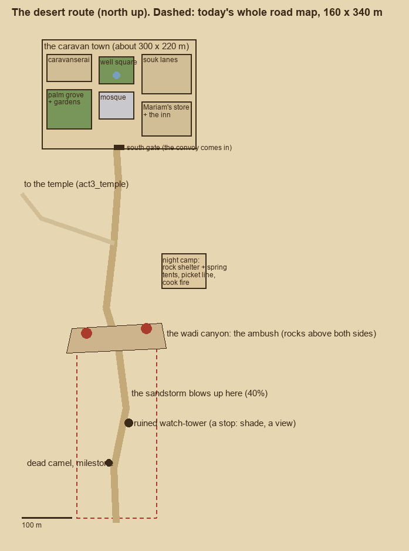
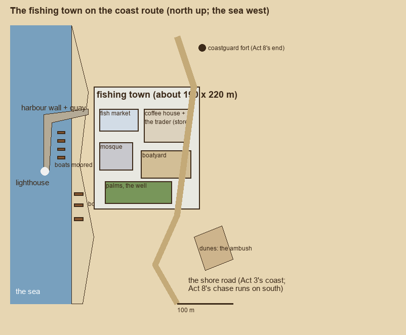
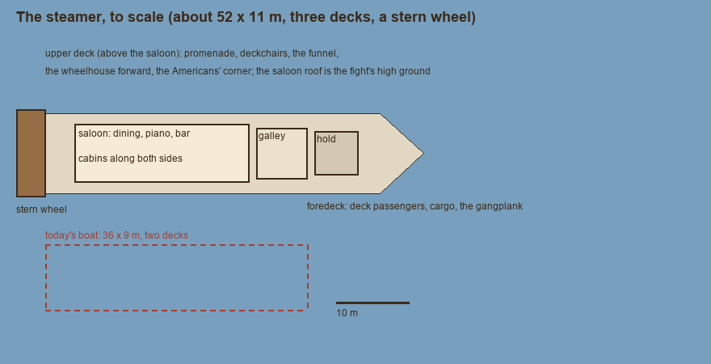
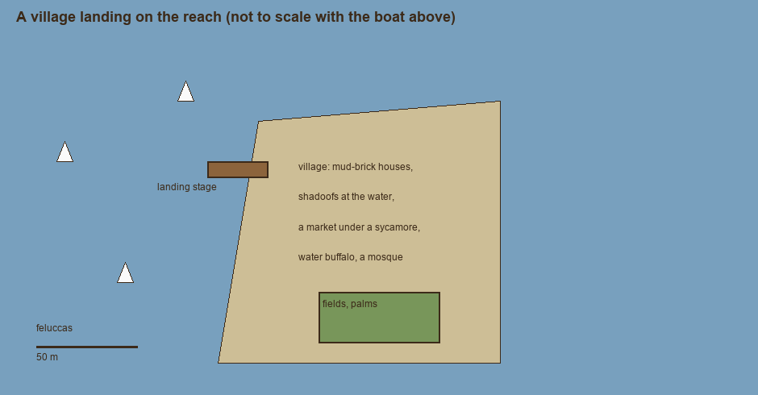

# The travel stops: a plan to "sell the travel" (draft, for approval before building)

*28 October 2026. A plan only: nothing is built. It goes to the lead and Simon first, the way [Cairo's](cairo_plan.md) did.*

Simon wants the journeys between Cairo and Akmentar to feel like journeys: places you arrive at, stay a night in, and remember, not a road with a few boxes at the end. This plan covers the three ways out of Cairo and back:
- **the desert route:** the road, its caravan town, the night camp, the wadi ambush;
- **the coast route:** a fishing town, its harbour, the shore road;
- **the riverboat:** the steamer as a place, and a landing on the way.

Numbers for today are from [the world audit](world_audit.md) (sections 2, 3, 4, 6 and 10). The models are cross-referenced to [the asset briefs](asset_briefs.md). Models the briefs don't have yet are listed at the end, **not sent**.

## What doesn't change

- **The flows and their ids.** Act 3's boards (`act3_route`, `act3_desert_branch`, `act3_coast_branch`) and their events stay: `desert_fork`, `temple_visit`, `ambush_town`, `riverboat_attack`, `coast_road`. So do Act 6's return (`act6_return`, the night on the road) and Act 8's routes (`boat_battle`, `temple_battle`, `chariot_chase`). The set pieces keep their scripts (act3_desert, act3_riverboat, act8_boat, act8_temple, act8_chase); only the places around them grow.
- **Money and time.** The per-head fares and "pay later" (87d3f17) stay as they are.
- **Companions at their own places.** -f9's CampJobs already has `act3_camp`, `act6_stop` and `act8_prep`. These plans give those jobs real places: a cook fire, a picket line, a deck rail, a wheelhouse.
- **The tests** (act3, act67, act89, the boards, retry, resume, the soak) must stay green at each stage.

---

## 1. The desert route: the road, the caravan town, the night camp, the ambush

**Today:** a 159 × 339 m map. A road runs north across a wadi (the ambush) to a few mud-brick boxes, "the town". The dunes are stretched spheres and the rocks are boxes, with 14 townspeople, no lights, and not one environment model. Act 3's night camp is only a talk: there's no camp geometry.

**The plan:**
- **Scale: about 3×.** The road becomes about 1 km from the start to the town gate, with the town itself about 300 × 220 m at the north end. Driving it takes 3–4 minutes, walking the town end to end about 75 s. The convoy keeps its formation code; only the road is longer.
- **The road, south to north:**
  1. **The start:** the convoy forms up at a well with a milestone.
  2. **A dead camel and a milestone:** the first sign of how far it is.
  3. **A ruined watch-tower** on a rise: shade, a view down the road, Youssef's lookout.
  4. **The sandstorm** blows up just past the tower (40% of the road, as now; Weather.sandstorm).
  5. **The wadi canyon:** today's dip becomes a canyon you can read, with rock shelves above both sides where the bandits wait. The ambush stays where it is in the flow, at the canyon.
  6. **The fork to the temple** (act3_temple): a side track west, marked by a toppled statue half in the sand.
  7. **The town gate.**
- **The caravan town:**
  - **Caravanserai:** a courtyard with arcades, the camels and horses in it; the convoy's arrival point.
  - **The well square:** the town's centre, with women at the well and a dovecote tower.
  - **The souk lanes:** covered stalls, a smith, a coffee seller.
  - **A small mosque** with a minaret: the skyline you see from the road.
  - **The palm grove and gardens:** green against the sand, irrigation channels.
  - **Mariam's store and the inn:** the resupply (act3_town) and a bed.
  - **The south gate** in a mud wall.
- **The night camp:** a rock shelter by a spring, off the road between the canyon and the town. Tents, a picket line of horses and camels, a cook fire with a pot, lanterns, the truck parked as a windbreak. This becomes Act 3's camp (today a talk only) and Act 6's night on the road back.

**Companions at their jobs (CampJobs):**
- **On the road:** riding in formation, as now. Youssef rides ahead to the watch-tower.
- **The night camp:**
  - Saleh at the spring (the water);
  - Naguib's porters at the picket line;
  - the cook fire (whoever has no job);
  - Hargreaves on watch on the shelter's rim;
  - Eleanor and Pembroke writing by a lantern;
  - Hassan watching the stars.
  - The rapport talks happen here (`act3_camp`, `act6_stop`).
- **The town:**
  - Farid haggling in the souk;
  - Mariam's store (the resupply);
  - Idris at the caravanserai gate;
  - the scholars at the mosque's old inscription.

**What you can see and do:**
- **In the town:**
  - resupply at Mariam's (act3_town);
  - ask the way (Rashid);
  - water at the well;
  - after the ambush, question the prisoners (act3_after_ambush).
- **On the road:** the watch-tower view. The camp's fire is where you save and sit with people.

**Set pieces and events:**

| Event / piece | Where |
|---|---|
| `desert_fork` (act3_fork) | at the fork |
| `temple_visit` (act3_temple) | down the side track |
| `ambush_town` (act3_desert) | the canyon, then the town |
| the sandstorm | past the watch-tower |
| Act 3's camp | the rock shelter |
| Act 6's night (act6_road, the servants) | the same shelter, at night, from the north |
| Act 8's `temple_battle` (act8_temple) | the temple, as now |

**Models:**
- **Briefed already:**
  - the rocks and ruins: desert_boulder, desert_rock_ledge, desert_rock_outcrop, desert_stones_scatter, desert_scrub, desert_acacia_dead, desert_camel_skeleton, desert_mudbrick_stub, desert_limestone_wall_broken, desert_column_drum, desert_masonry_pile, desert_milestone;
  - the canyon walls and skyline: `des_cliff_face`, `des_butte`;
  - the town: `town_mudbrick_wall`, `town_doorway`, `town_roofline`, `town_dovecote`, `town_well`;
  - reused from Cairo: `cai_minaret` and `cai_mosque_dome` for the mosque, `cai_awning` for the souk, `cai_gate_arch` and `cai_gate_tower` for the south gate.
- **Missing (listed below, not sent):** a caravanserai arcade, a watch-tower ruin, a toppled half-buried statue, and camp gear (cook tripod, water barrels, camp table, picket line, lantern pole).

**Questions for Simon:**
1. Is about 1 km of road right for the drive (3–4 minutes)? Or should the road be shorter, with more stops?
2. Should the town be somewhere you can stay a night (the inn as a save and a rapport stop), or a place you pass through?
3. The night camp as a rock shelter by a spring: or would you rather an oasis, or a ruined caravanserai?
4. Should Act 6's way back reuse this camp, so you return to a place you know, or have its own?

---

## 2. The coast route: the fishing town, the harbour, the shore road

**Today:**
- **Act 3's coast branch** reuses the desert road's map (159 × 339 m) with a flat sea plane on the west and the same mud-brick boxes for a town.
- **Act 8's chase** has its own 1.5 km shore road, rocks as boxes and a coastguard fort as a box with a gap.

**The plan:**
- **Its own map: the shore road** about 1 km along the sea, at about 3×, matching the desert's. It runs past dunes (the coast ambush), a wreck on the beach and a fishing town, with the coastguard fort on the headland beyond the town. **One shore for both acts:**
  - **Act 3** drives north to the town.
  - **Act 8's chase** starts here and runs south on the existing 1.5 km chase road, so the fort is the same fort.
- **The fishing town (about 190 × 220 m):**
  - **The harbour:** a stone harbour wall with a quay, boats moored, the lighthouse at its end.
  - **The beach:** boats pulled up, net-drying racks, men mending nets.
  - **The fish market:** stalls by the quay, gulls.
  - **A coffee house and the trader:** the resupply, as Mariam's on the desert road.
  - **A boatyard:** a hull on stocks.
  - **A small mosque, palms and a well.**
  - Whitewashed houses with blue doors, a different palette from the desert town.
- **The camp:** on the coast, the trucks are the camp, drawn up on the beach by the dunes. A fire in their lee, the sea for sound.

**Companions at their jobs:**
- the drivers at the trucks (the truck seats, as now);
- Naguib checking loads;
- Farid at the fish market;
- Hargreaves on the dune crest on watch;
- the scholars at the lighthouse keeper's (he keeps old charts);
- Isabelle at the coffee house.

**What you can see and do:**
- resupply at the trader's;
- talk to the lighthouse keeper (news of the road, rival expeditions);
- the harbour at sunset;
- the wreck on the beach (a clue spot if wanted).

**Set pieces and events:**

| Event / piece | Where |
|---|---|
| `coast_road` (stay on the coast) | the shore road |
| `ambush_town` by the coast (act3_coast) | the dunes, then the town |
| Act 6's coast return | the beach camp by the trucks |
| Act 8's `chariot_chase` | from the town south along the shore, to the fort |

**Models:**
- **Briefed already:** `coast_house_wall`, `coast_fishing_boat`, `coast_net_rack`, `coast_harbour_wall`, `coast_lighthouse`, `fort_wall`, `fort_bastion`, `fort_gatehouse`, desert_shore_rock. Feluccas in the harbour reuse `cai_felucca`.
- **Missing:** a fish-market stall, a beached wreck, a boat on stocks, mooring bollards with a coiled-rope block, and a whitewashed coffee-house front.

**Questions for Simon:**
1. Should the coast and the chase share one shore, Act 3 north and Act 8 south, so the fort and the town are the same places?
2. The trucks as the coast camp: or a proper camp in the town's khan?
3. Should the lighthouse keeper be a character with something to tell (a rival seen, the old charts)? Or is he scenery?

---

## 3. The riverboat: the steamer as a place, and a landing

**Today:** a 36 × 9 m two-deck boat of boxes on a 775 m reach. The banks are flat sheets with palms and reeds, there's no land to walk and 4 things to use. Act 3's attack and Act 8's battle both happen on its deck.

**The plan:**
- **The boat: about 52 × 11 m, three levels**, a period Nile stern-wheeler (Thomas Cook's Karnak and Sudan):
  - **Main deck aft:** the saloon (dining tables, a piano, a bar) with cabins along both sides of a corridor.
  - **Main deck forward:** the galley, the hold, and the foredeck with deck passengers, cargo and the gangplank.
  - **Upper deck:** a promenade with deckchairs, the funnel, the wheelhouse forward, and the Americans' corner (Whitfield's party is aboard in Act 3).
  - **The stern wheel** turning; the engine's sound and smoke.
  - The saloon roof stays the fight's high ground, as the deck battle needs it.
- **The reach:** about 1.5–2 km at 2×+, the far bank far, with the banks' life drawn in:
  - villages with shadoofs, water buffalo in the shallows, palms, fields;
  - a temple on the bank sliding past;
  - feluccas.
- **A landing:** one stop where the boat ties up: a timber landing stage, a village with a market under a sycamore, a small mosque, the fields. You can go ashore for a stretch, which is the river route's "town".

**Companions at their jobs:**
- Hargreaves and Idris at the rails on watch;
- the scholars in the saloon with books (Pembroke cataloguing at a table);
- Farid in the hold with the stores;
- crews on the foredeck with the cargo;
- Isabelle on the upper deck;
- Eleanor at the bow;
- Hassan watching the bank for the Keepers' riders.
- The rapport talks happen in the saloon and on deck.

**What you can see and do:**
- talk to the captain (Hamdi in Act 2) in the wheelhouse;
- eat in the saloon with the Americans (Whitfield's wager, the rivals' talk);
- go ashore at the landing (the market, water, a story beat);
- watch the river from the promenade.

**Set pieces and events:**

| Event / piece | Where |
|---|---|
| Act 3's `riverboat_attack` (act3_riverboat) | on the deck, with the Americans aboard |
| Act 8's `boat_battle` (act8_boat, the servants' waves, holding the deck, the carrier) | the same boat, at night |
| the landing | between the start and the attack (Act 3); in Act 8 the boat doesn't stop |

**Models:**
- **Briefed already:** `boat_saloon_wall`, `boat_cabin_row`, `boat_paddle_wheel`, `boat_funnel`, `boat_wheelhouse`, `boat_rail`, `boat_landing`, `boat_shadoof`. Feluccas reuse `cai_felucca`, the village's houses reuse `town_mudbrick_wall` and `town_roofline`, and the bank temple reuses the temple kit.
- **Missing:** the saloon's furniture (dining table and chairs, an upright piano, a bar counter), a deckchair, a cabin bunk, a sycamore tree, and the hull itself as modules (a bow section, a hull side, a stern).
- **Not props:** water buffalo, camels and donkeys go through the character pipeline (as the briefs note).

**Questions for Simon:**
1. Is 52 m right, a real Cook's steamer? Or bigger and grander, or smaller and shabbier, for a "cheapest passage" boat?
2. Should the landing be a place to spend time (a story beat, a market), or only a view as you pass?
3. Should you be able to go inside the saloon and cabins (built in Godot as -f9 did Cairo's interiors), or only walk the decks?
4. Act 8's boat at night: the same boat? Or a different, darker one, since Hamdi's steamer was attacked in Act 3?

---

## Missing models (listed here, **not sent** to image-to-3d)

| Place | Asset | Kind |
|---|---|---|
| Desert | Caravanserai arcade (tileable: arches over a gallery) | module |
| Desert | Watch-tower ruin | one-off |
| Desert | Toppled statue, half buried | kit |
| Camps | Cook tripod with a pot | kit |
| Camps | Water barrels (a group) | kit |
| Camps | Camp table with stools | kit |
| Camps | Picket line (posts with a thick rope rod) | kit |
| Camps | Lantern pole | kit |
| Coast | Fish-market stall | kit |
| Coast | Beached wreck | one-off |
| Coast | Boat on stocks | kit |
| Coast | Mooring bollards with coiled rope (solid) | kit |
| Coast | Whitewashed coffee-house front | one-off |
| River | Saloon dining table and chairs | kit |
| River | Upright piano | kit |
| River | Bar counter | kit |
| River | Deckchair | kit |
| River | Cabin bunk | kit |
| River | Sycamore tree | kit |
| River | Steamer hull modules (bow, side, stern) | module |

That's 20 more, about 2 one-hour holds. With the 56 + 28 already in the briefs, the whole world pass is about 11 holds.

*Story text and place names are placeholders; these plans are places only.*
