# World audit: every place against the bar

*27 October 2026. Measured, not estimated: `tests/world_audit.tscn` opens each place in its own act, then measures it.*

**The bar** is Simon's: Cairo, the boats and every stop on the route should have the tomb target's monumental scale ([`reference/tomb_look`](reference/tomb_look/)), plus room to explore and things to see. Today they are compact blockouts.

**The short version:**
- **Size.** Every place is small. The biggest you can walk is about 160 × 340 m (the desert road). Cairo is 139 × 127 m. Simon's target valley has a 500 m scale bar and runs over a kilometre.
- **Blockout.** Almost everything is boxes: 85–99% of the meshes in every place except the temple (57%) and Akmentar's surface (40%).
- **Models.** The modelled pieces are mostly people, crates and the dungeon kit (pillars, glyph walls, sconces). There are no buildings, rocks, boats or monuments as real models yet.
- **Crossing on foot.** Most places take under a minute and a half at a walk. Cairo's farthest point is 26 s from where you arrive.

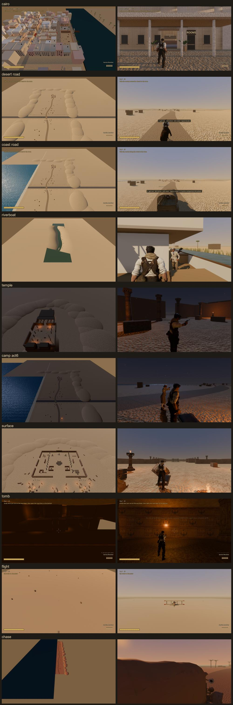

## How to read the numbers

- **Walkable:** the navmesh's extent, where a person can go, and its area.
- **Longest walk:** the longest real path from where you arrive to anywhere you can reach. Walk speed is 4 m/s; sprint is 6.6 m/s.
- **Blockout %:** the share of meshes that are primitive boxes, cylinders and spheres, against modelled GLB pieces. Measured with the draw-call merge off, so boxes count as boxes.

---

## 1. Cairo (Acts 1, 2 and 7, with -f9's interiors)

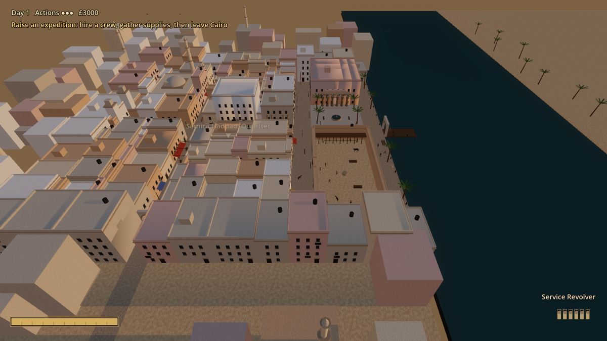

- **Size:** 139 × 127 m walkable (21,000 m²). With the river and the skyline, the geometry spans 558 × 400 m.
- **Crossing:** the longest walk is 104 m: 26 s walking, 16 s sprinting.
- **In it:**
  - **Places:** the hotel, museum, consulate, bank, telegraph office, club, outfitters, gunsmith, tavern and café, mosque, bazaar, dealer, station, police, south gate, caravanserai and docks.
  - **Interiors:** 10 rooms.
  - **People:** 40 crowd people (walkers, porters, stall customers, sitters) and 32 named people.
  - **Interaction:** 27 things to use. 60 lights.
- **Blockout:** 94%: 4,159 boxes against 260 modelled meshes.
  - **Models:** 26 distinct. Of 219 placed, 122 are crates.
  - **Buildings:** every one is a plaster box with box windows and box awnings. The domes and minarets are primitives, and the river is a flat plane.
- **Missing against the bar:**
  1. **Room.** A city you can walk round in two minutes. 1920s Cairo wants 3–4× the walkable area, with districts that feel different: the old city's lanes, the European quarter's boulevards, the docks.
  2. **Monumental landmarks.** A real mosque and citadel skyline, the museum as a great neoclassical facade, Ottoman houses with mashrabiya screens. At the moment every building is the same box at a different size.
  3. **Narrow, layered streets.** A covered souk to get lost in, alleys, stairs, rooftops, courtyards. Today it is a grid of flat-fronted blocks.
  4. **The Nile front.** Feluccas, a real quay, the steamer at its landing with people boarding. Today it's a flat blue plane.
  5. **Things to see between the talks.** Stalls piled with goods, workshops, a café terrace, a funeral or a wedding passing. The crowd is there, but there's little for it to be around.

## 2. The desert road and its town (Act 3, the desert branch; Act 3's night camp)

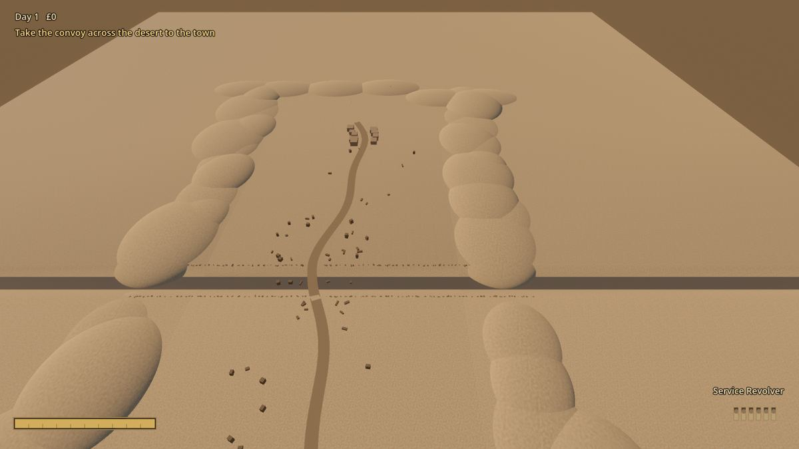

- **Size:** 159 × 339 m walkable (53,500 m²), the largest walkable place in the game.
- **Crossing:** the longest walk is 315 m: 79 s walking.
- **In it:**
  - **The road:** a road running north across a wadi (the ambush spot) to a few mud-brick houses at the north end ("the town").
  - **People and things:** 14 townspeople, 2 things to use, no lights.
  - **Act 3's night camp** is only a talk on this road: there is no camp geometry at all.
- **Blockout:** 94%.
  - **Models:** 7 distinct, all characters, horses and a truck. There is not one environment model.
  - **Placeholders:** the dunes are stretched spheres, the rocks are boxes and the town's houses are boxes.
- **Missing against the bar:**
  1. **A town worth arriving at.** A well and square, a souk, an inn, a mosque, walls and a gate, people at work. Today it's a handful of boxes at the end of the road.
  2. **Real desert.** Wind-shaped dunes with scale, rock formations, the wadi as a canyon you can read, and a horizon that goes on.
  3. **Things along the way.** A ruin, a caravan, a dead camel, a well, an old fort: reasons to stop and look.
  4. **The night camp as a place:** tents, picketed horses, a cook fire, the companions at their jobs.

## 3. The coast road and its town (Act 3, the coast branch)

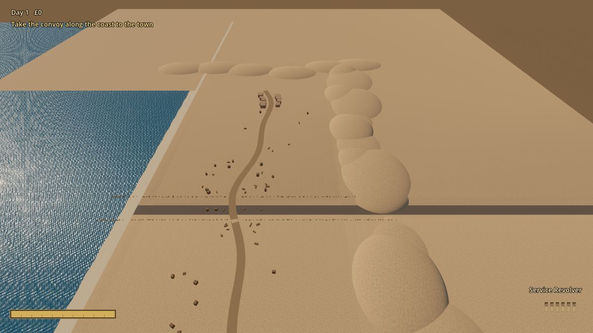

- **Size and crossing:** the same map as the desert road (159 × 339 m walkable, 79 s walking), with the sea along the west side.
- **In it:** the same road, wadi and town, plus 2 trucks.
- **Blockout:** 92%. The sea is a flat plane; nothing else changes from the desert version.
- **Missing against the bar:**
  1. **A coast town of its own.** A fishing village with boats pulled up, nets, a harbour wall, a lighthouse. It currently reuses the desert town's boxes.
  2. **A real shore.** Cliffs, coves, a beach with wrecks and driftwood, surf.
  3. **Its own character.** Today it's "the desert road with water on the left".

## 4. The river and the riverboat (Act 3, the river branch; Act 8's boat)

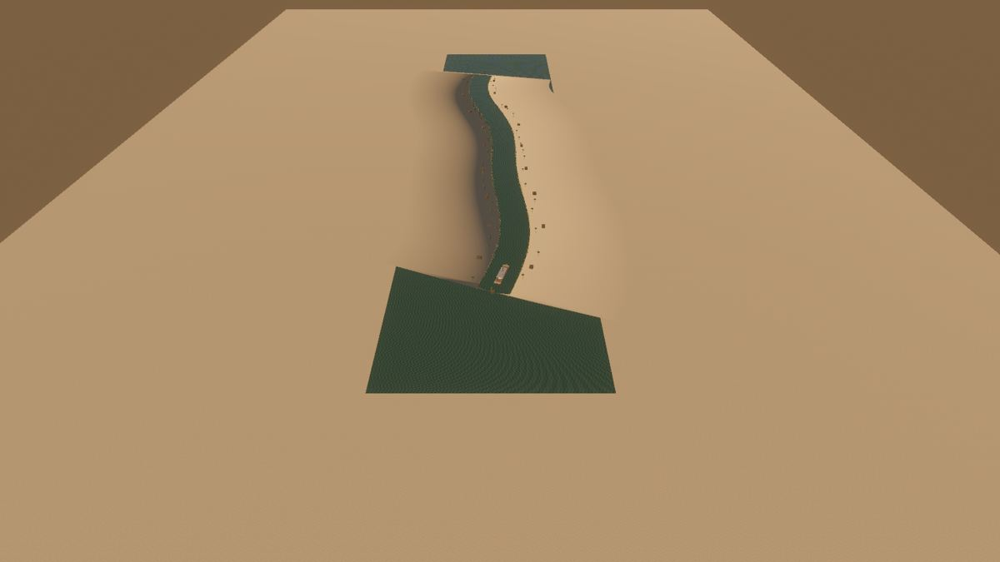

- **Size:** a 775 m reach of the Nile, 156 m wide. You walk only the deck: the boat is 36 m long. There's no land to walk.
- **In it:** the steamer (boxes), banks with palms and reed beds, people on the deck, 4 things to use.
- **Blockout:** 97%. The whole boat is boxes, and the banks are flat sheets.
- **Missing against the bar:**
  1. **The boat as a place.** A real paddle steamer: a saloon, cabins, the wheelhouse, the paddle wheel turning. Somewhere to walk round and talk, not a deck of boxes.
  2. **The river's life.** Villages on the banks, feluccas, water buffalo, shadoofs (water-lifting poles), a temple on the bank sliding past.
  3. **Stops.** A landing where you can go ashore.
  4. **Scale.** The Nile is wide, and the far bank should be far.

## 5. The desert temple (act3_temple and act8_temple)

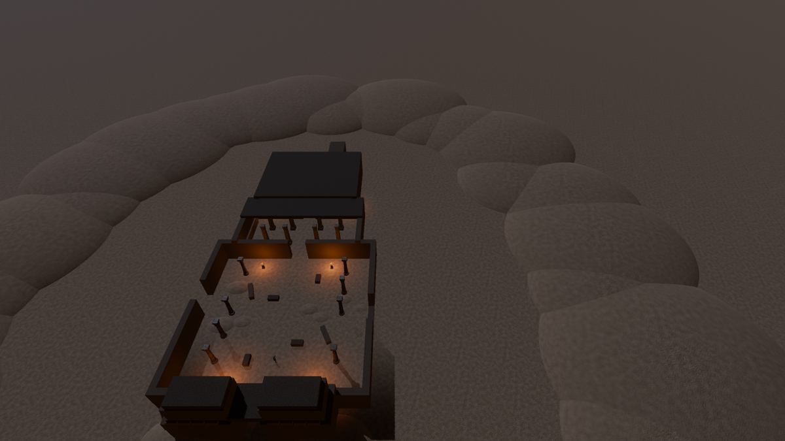

- **Size:** 99 × 139 m walkable (13,900 m²).
- **Crossing:** the longest walk is 139 m: 35 s walking.
- **In it:**
  - **The building:** a pylon gate, a columned court with fire pillars, a hypostyle hall and the sanctuary with Anubis, Horus and Ra.
  - **The rest:** a hidden rear passage, 9 lights, 2 things to use.
- **Blockout:** 57%, the best ratio in the game.
  - **Modelled:** 72 placed pieces: glyph walls and friezes, square and papyrus pillars, fire pillars, sconces, statues.
  - **Boxes:** the walls, the pylon and the sand drifts.
- **Missing against the bar:**
  1. **Monumental scale.** The pylon and columns are human-sized. The target's columns are three storeys high, and its statues are colossi.
  2. **Colour.** Painted reliefs in blue, red, green and gold, and star-painted ceilings. Today it is plain sandstone.
  3. **An approach.** A sphinx avenue in the sand, half-buried colossi, the dig's trenches and spoil heaps.
  4. **Rooms beyond the axis.** Side chapels, crypts and a roof to climb.

## 6. The night camps (Act 6 on the road back; Act 3's has no geometry)

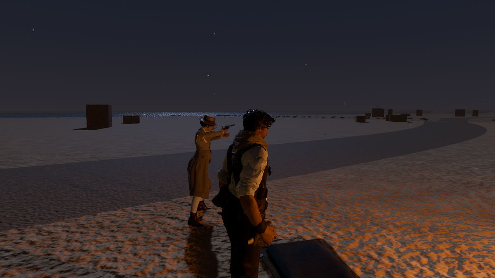

- **Size:** the desert road's map (159 × 339 m walkable). The camp itself is a fire and three bedrolls.
- **In it:** the campfire, 3 bedrolls, the party, 1 light. 0 things to use.
- **Blockout:** 93%, the road's.
- **Missing against the bar:**
  1. **A camp:** tents, picketed horses and camels, a wagon or truck, crates, a cook fire with a pot, lanterns.
  2. **Companions at their own things:** someone cooking, someone on watch, someone writing (Simon's rule).
  3. **A setting:** an oasis, a ruined caravanserai or a rock shelter, not the open road.

## 7. Akmentar's surface (Acts 4 and 9)

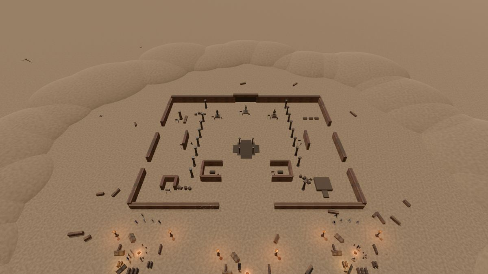

- **Size:** 139 × 139 m walkable (18,000 m²).
- **Crossing:** the longest walk is 154 m: 39 s walking.
- **In it:**
  - **The ruins and camps:** a ruined temple court with the 12 investigation sites, three expedition camps and the sealed tomb door.
  - **People and things:** 14 workers and 4 named people, 18 things to use, 12 lights.
- **Blockout:** 40%, the lowest in the game. Of 199 placed models, 132 are crates. The court's walls are boxes.
- **Missing against the bar.** This is the farthest from Simon's target, the Golden Pharaoh valley:
  1. **The valley:** a cliff-carved facade with four colossi, terraces, side temples, a watcher's ledge, and the river with waterfalls. Today it is a walled square in flat sand.
  2. **A processional approach:** the desert approach, a royal causeway with stairs, the first pylon, an avenue of statues, a ceremonial plaza and an obelisk court.
  3. **Scale:** the target spans over a kilometre (its 500 m scale bar). Today it is 140 m.
  4. **Colour and gold:** painted reliefs, gilded facades, a sacred lake.

## 8. The tomb (Acts 5 and 9)

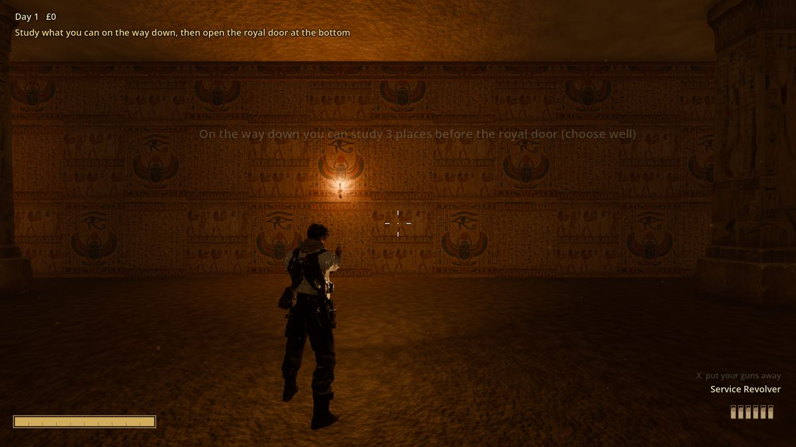

- **Size:** 127 × 111 m across and 42 m deep: five levels and a great shaft, 39,600 m² walkable in all.
- **Crossing:** the longest walk is 271 m: 68 s walking, 41 s sprinting.
- **In it:**
  - **The structure:** the Weeping Stair round the shaft, two bridges, chambers and corridors on every level, secret walls, the royal door and the royal tomb.
  - **Furnishing:** 227 wall sconces, about 150 pillars, 271 lights, 14 things to use.
- **Blockout:** 85%. The rock, floors, stairs and balustrades are boxes. The glyph walls, pillars and sconces are modelled.
- **Missing against the bar:**
  1. **Hypostyle halls:** huge painted papyrus columns and star ceilings. The halls are big now, but plain.
  2. **Osiride statues** lining a court, and colossi at the royal door.
  3. **Colour:** painted reliefs throughout, not sandstone texture.
  4. **Chambers with their own character:** a treasury, a flooded hall, a pit room, an embalming hall.
  5. **The great shaft as a sight:** carved walls, a statue rising through it, light falling from above.

## 9. The flight range (Act 8)

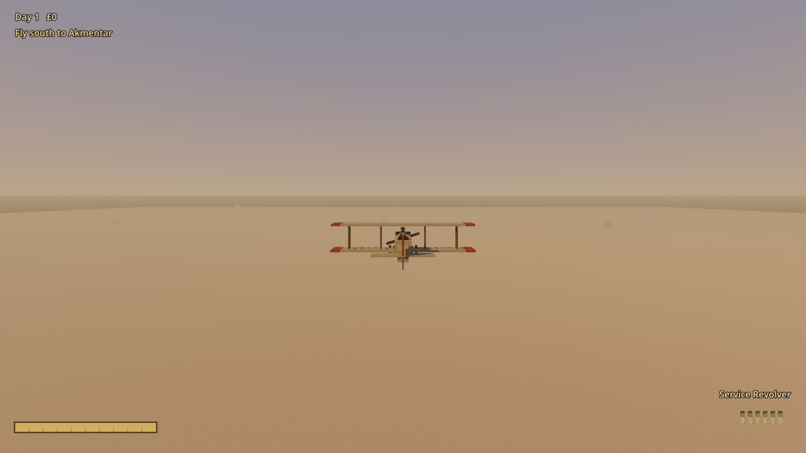

- **Size:** 3.2 × 6.1 km of desert. You fly over it, you don't walk it.
- **In it:** the airstrip, dunes, rock outcrops, Cairo's minarets on the horizon behind, and the storm wall.
- **Blockout:** 99%. The dunes are spheres and the rocks are boxes.
- **Missing against the bar:**
  1. **Things to fly over:** the pyramids, the Nile with its green strip, oases, a caravan, ruins.
  2. **A sky:** clouds, and the sandstorm as a real wall of dust rather than a coloured box.
  3. **Terrain with shape:** escarpments, wadis, a valley to fly down.

## 10. The chariot-chase road (Act 8)

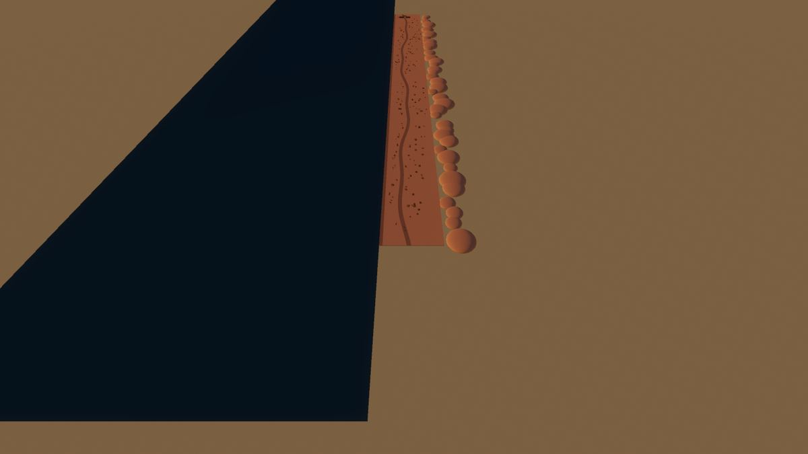

- **Size:** a 1.5 km coast road, 177 m wide in all, driven not walked.
- **In it:** the road, the beach, rocks, the sea, a coastguard fort at the end, and the trucks.
- **Blockout:** 98%. The rocks and the fort are boxes.
- **Missing against the bar:**
  1. **A road with set pieces:** a village to tear through, a bridge, a cliff edge, wrecks to swerve round.
  2. **The fort as a fortress:** walls, a gatehouse, a flag. Today it's a box with a gap.
  3. **The coast:** cliffs, coves, waves breaking.

---

## Across all of them

- **Scale:** a 2–4× pass on the open places. Cairo, the surface, the road town and the coast town all need far more ground and longer sight lines.
- **Real models for what's still boxes:** buildings, rocks and cliffs, boats, monuments (colossi, pylons, obelisks, sphinxes) and camp gear. These are image-to-3d briefs.
- **Colour:** painted Egyptian surfaces for the temple, the tomb and the surface. Every place is plain sandstone now.
- **Places within places:** each stop needs things to walk to and look at, not only a path between two talks.
- **Companions at their own places:** -f9's CampJobs has started this for Act 4. The camps, Cairo and the boat need the same.

*The story text you see in talks and clues is placeholder (Simon is reworking it). This audit is about places only.*

## How to re-measure

Run it windowed, one Godot at a time:

```
godot --path . res://tests/world_audit.tscn -- --list
godot --path . res://tests/world_audit.tscn -- <args from a PLACE line> --shot-dir=C:/path
```

Each run prints an `AUDIT {json}` line with every number above, and saves `<place>_overview.png` and `<place>_player.png`.
